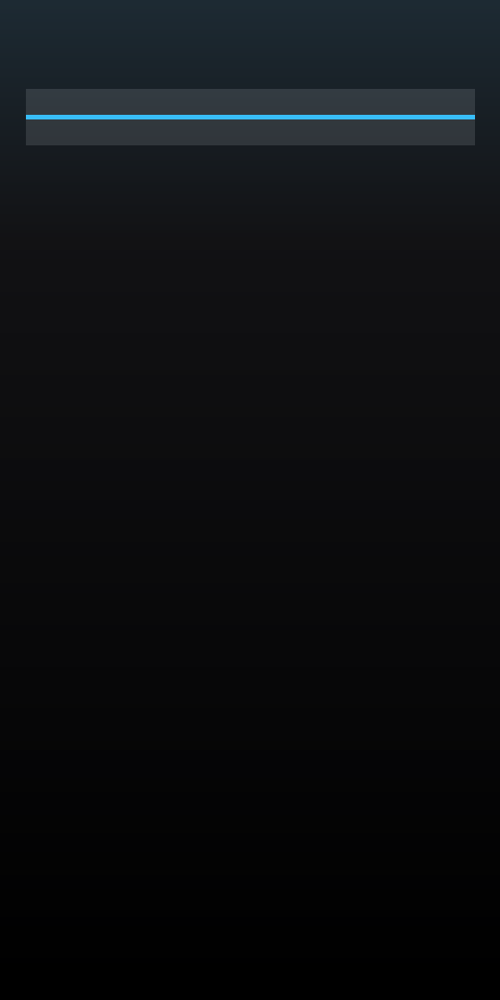
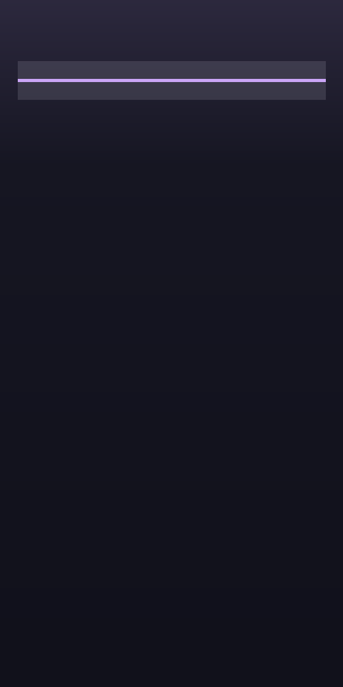
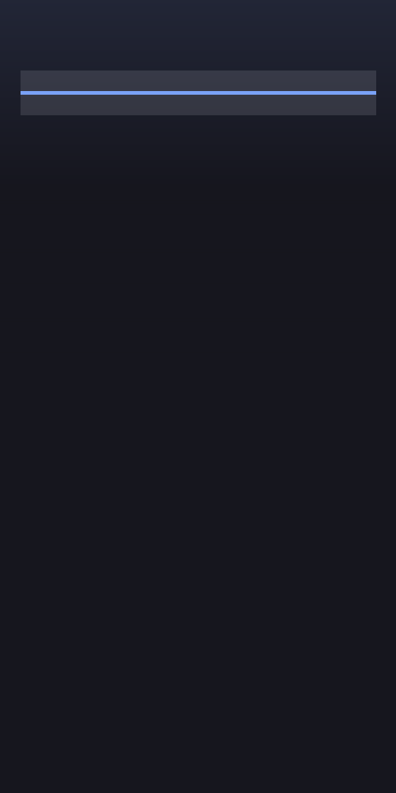
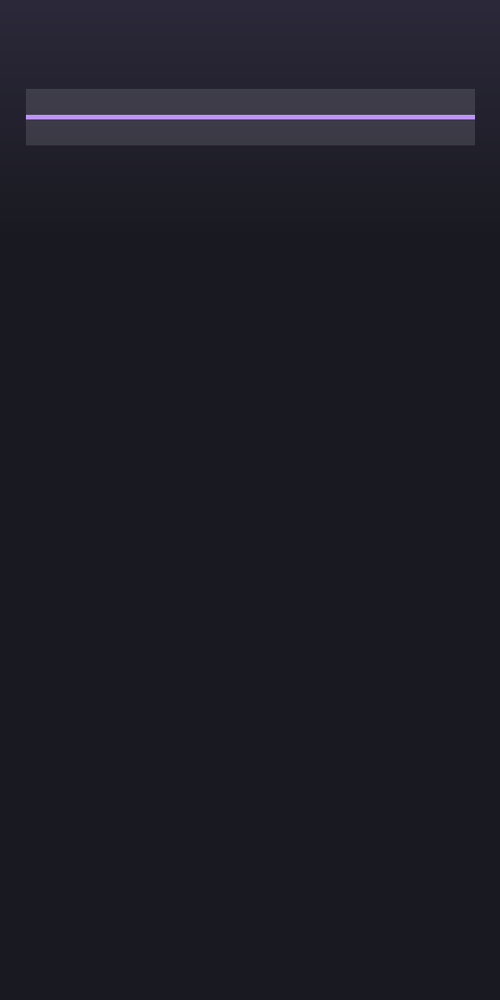

<div align="center">

# NeoTerm



**A modern 2026 Liquid Glass terminal emulator for Android — engineered for 120Hz smoothness, dynamic floating pill sessions, live process indicators, and synchronized color schemes.**

[](https://github.com/DiemMyCodex/NeoTerm/actions/workflows/debug_build.yml)
[](https://github.com/DiemMyCodex/NeoTerm/releases/latest)
[](LICENSE.md)
[](https://developer.android.com/about/versions)
[](CONTRIBUTING.md)

</div>

---

## Visual showcase

| OLED Obsidian | Catppuccin Mocha |
|:---:|:---:|
|  |  |
| **Maximum contrast, zero distraction** | **Warm pastel developer favourite** |

| Tokyo Night | Dracula |
|:---:|:---:|
|  |  |
| **Electric blue, neon accents** | **Classic purple & pink** |

> Placeholders ship in the repo so links never break. Replace them with real captures using [`scripts/capture_showcase.sh`](scripts/capture_showcase.sh).

---

## Why NeoTerm?

NeoTerm keeps the battle-tested Termux engine — terminal emulator, bootstrap, plugins — and replaces the surrounding UI with a floating, glass-styled terminal workspace. Every interaction is designed around the soft keyboard: the terminal always keeps focus.

### Feature matrix

| Area | What you get |
|:---|:---|
| **Floating Pill Tab Bar** | Sessions live in a translucent, rounded top bar. The active pill scrolls fully into view so its close button is never blurred by a fading edge. |
| **Live `/proc` Status Dots** | Each tab shows a green idle / amber busy dot, computed on a single daemon thread at 1.8s intervals. Main-thread redraws happen **only on real state changes**. |
| **Synchronized 2026 Themes** | Four curated schemes — Obsidian, Catppuccin Mocha, Tokyo Night, Dracula — recolor the ANSI canvas **and** the glass chrome, keycaps, tab pills and ambient glow in one tap. Persisted across cold launches. |
| **Haptic Collapsible Glass Dock** | Extra keys collapse to a compact right-pinned pill with a 180° chevron rotation; expansion restores a weighted `ViewPager` with an alpha fade. No width animation, so keycaps never measure at zero. |
| **Zero-Lag Keyboard Focus Contract** | `TerminalView` is the only focusable view. All chrome is `focusable=false` with `blocksDescendants`, and `restoreTerminalFocusAndIme()` is called on every chrome dismissal. Typing never loses the IME. |
| **120Hz & Battery Friendly** | Off-main-thread process scanning, change-gated UI updates, no polling for theme work, no layout transitions on the dock. |

### Engineering highlights

- **Pure-JVM theme core.** `ThemeRegistry` / `TerminalThemeSpec` are plain Java models with zero Android UI dependencies, so the four palettes and all chrome colors are unit-tested directly on the JVM.
- **Design tokens.** Every 2026 color and dimension is a semantic `neoterm_*` resource in `app/src/main/res/values/` and `termux-shared/src/main/res/values/` — no magic hex scattered through drawables.
- **Testable state contracts.** Dock collapse/expand, tab formatting, selection and monitor lifecycle are expressed as small pure classes with fast JUnit coverage.
- **Native Android only.** No new Gradle dependencies were added for the UI work — just `View`, `Drawable`, `PopupWindow`, `SharedPreferences` and the AndroidX libraries already in the project.

---

## Quick install

### Download a release (recommended)

1. Open [**Releases**](https://github.com/DiemMyCodex/NeoTerm/releases/latest).
2. Download **`*_arm64-v8a.apk`** under **Assets** (Android 7+ / arm64 devices).
3. Download **`*_sha256sums`** from the same release and verify:

```bash
sha256sum -c termux-app_*_sha256sums
# expect: <downloaded-apk>: OK
```

4. Tap the APK to install. Android will ask once to allow installs from unknown sources.

> This build uses Termux's public test signing key, so it cannot be mixed with F-Droid or Play Store Termux installs. Uninstall those first, and back up `$HOME` before switching sources.

### Build locally

Requirements: **JDK 17**, Android SDK platform + NDK versions from `gradle.properties`, and network access for the bootstrap zip.

```bash
git clone https://github.com/DiemMyCodex/NeoTerm.git
cd NeoTerm
./gradlew assembleDebug
```

The ARM64 debug APK lands in `app/build/outputs/apk/debug/`. Run the fast unit suite with:

```bash
./gradlew test
```

---

## Documentation

- [Contributing guide](CONTRIBUTING.md)
- [Changelog / architectural milestones](CHANGELOG.md)
- [Issue templates](.github/ISSUE_TEMPLATE/)
- [Upstream Termux docs](https://wiki.termux.com/wiki/Terminal_Settings)

---

## Credits & License

NeoTerm is a fork of **[termux/termux-app](https://github.com/termux/termux-app)** by the Termux maintainers and contributors. The terminal emulator, bootstrap packaging and shared libraries remain their work. This project is **not affiliated with or endorsed by the Termux project**.

- App code: **GPL-3.0 only** — see [LICENSE.md](LICENSE.md).
- `terminal-view` / `terminal-emulator` derive from *Terminal Emulator for Android* (Apache 2.0).
- `termux-shared`: MIT with the exceptions documented in [`termux-shared/LICENSE.md`](termux-shared/LICENSE.md).
- Theme palettes: Catppuccin Mocha, Tokyo Night and Dracula are community color schemes; their names and color values are used with attribution to their respective projects.

Built with the native Android SDK. No external UI dependencies added.
